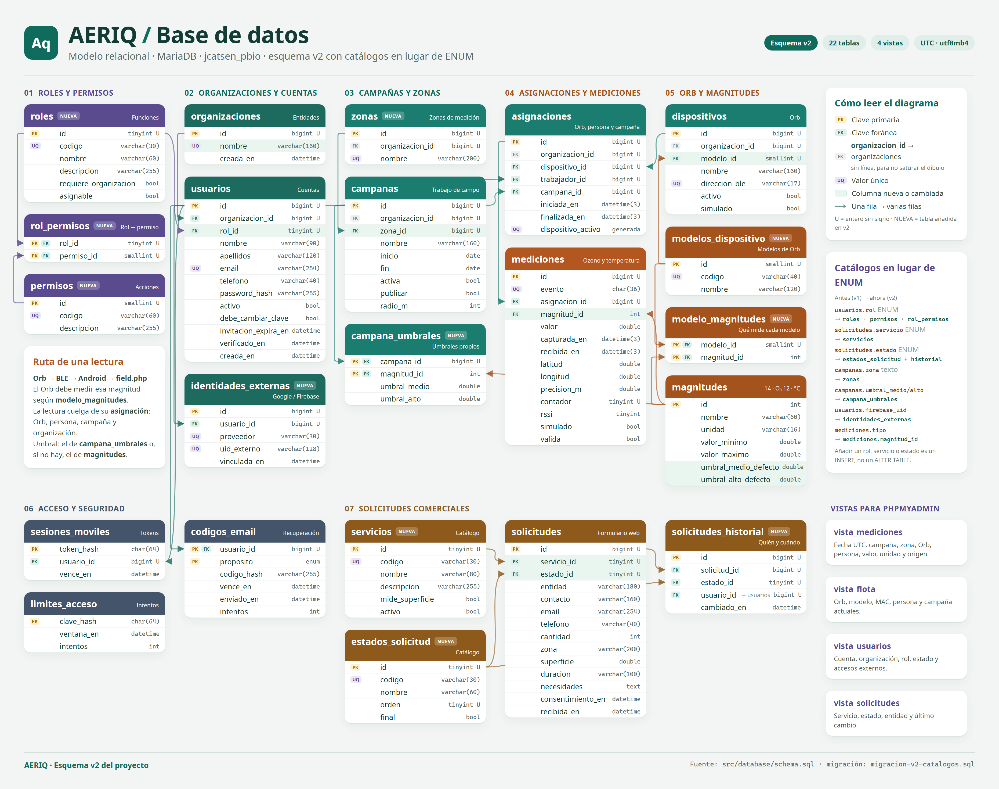
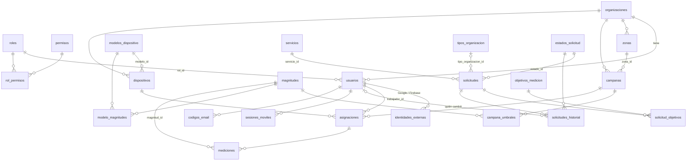

# Modelo de datos

AERIQ usa 25 tablas y 4 vistas en MariaDB. El esquema completo está en [schema.sql](../src/database/schema.sql). Una base existente se actualiza con [migracion-v2-catalogos.sql](../src/database/migracion-v2-catalogos.sql) (v1 → v2) y después [migracion-v3-solicitudes.sql](../src/database/migracion-v3-solicitudes.sql) (v2 → v3). Las dos conservan todos los datos. Una instalación limpia se hace con [Reinstalar AERIQ](../src/database/reinicio/LEEME.md).

La versión 2 del esquema sustituye los `ENUM` y los textos repetidos por **tablas de catálogo**. Un catálogo es una tabla pequeña con un `id`, un `codigo` estable que usa el programa y un `nombre` legible. Para añadir un rol, un permiso, un servicio o un estado basta con insertar una fila; no hace falta modificar la tabla ni el código.



`aeriq-esquema-v2.png` es el diagrama de esta versión. `aeriq-esquema-actual.png` y `base-de-datos.png` son diagramas de versiones anteriores. Este es el mismo esquema en texto:

## Diagrama



`limites_acceso` no se relaciona con ninguna tabla: solo cuenta intentos para frenar ataques de fuerza bruta.

## Tablas

| Grupo | Tabla | Qué guarda |
| --- | --- | --- |
| Catálogos | `roles` | Funciones de una cuenta: código, nombre, descripción, si necesita organización y si un administrador puede concederla |
| | `permisos` | Acciones que el servidor comprueba (`informes.ver`, `mediciones.registrar`…) |
| | `rol_permisos` | Qué permisos tiene cada rol (relación muchos a muchos) |
| | `magnitudes` | 14 = ozono (ppb) y 12 = temperatura (°C), con su rango válido y sus umbrales de referencia |
| | `modelos_dispositivo` | Modelos de Orb fabricados (hoy solo `orb-v1`) |
| | `modelo_magnitudes` | Qué magnitudes mide cada modelo |
| | `servicios` | Qué se puede solicitar (kits, estudio, asesoramiento), su orden y si piden datos de estudio |
| | `tipos_organizacion` | Quién solicita: administración pública, empresa u otra entidad |
| | `objetivos_medicion` | Para qué quiere medir el cliente (espacios públicos, salud laboral…) |
| | `estados_solicitud` | Estados de una solicitud comercial, su orden y si cierran el proceso |
| Cuentas | `organizaciones` | Entidades cliente y Código Norte. El nombre es único |
| | `usuarios` | Identidad, organización, `rol_id`, contraseña (hash), activación e invitación |
| | `identidades_externas` | Vínculo de una cuenta con un proveedor externo (Firebase/Google) por su UID |
| Campañas y flota | `zonas` | Zonas de medición reutilizables por organización |
| | `campanas` | Zona, fechas, publicación y radio de interpolación |
| | `campana_umbrales` | Umbrales propios de una campaña para una magnitud |
| | `dispositivos` | Orb: organización, modelo, MAC BLE, alta y procedencia real o simulada |
| | `asignaciones` | Historial Orb–trabajador–campaña, con una sola asignación abierta por Orb |
| Mediciones | `mediciones` | Evento único, asignación, magnitud, valor, fechas UTC, GPS opcional y validez |
| Solicitudes | `solicitudes` | Peticiones de presupuesto de la web |
| | `solicitud_objetivos` | Objetivos marcados en cada solicitud (uno o varios) |
| | `solicitudes_historial` | Cada cambio de estado: qué estado, quién y cuándo |
| Seguridad | `codigos_email` | Hash de los códigos de recuperación de un solo uso |
| | `sesiones_moviles` | Hash del token de la app y su caducidad |
| | `limites_acceso` | Contadores de intentos por ventana de tiempo |

Las vistas `vista_mediciones`, `vista_flota`, `vista_usuarios` y `vista_solicitudes` muestran los datos con nombres en lugar de identificadores para leerlos en phpMyAdmin. No copian datos y la web no las usa.

## Preguntas de diseño

Cada tabla se revisó con tres preguntas: ¿es lógica?, ¿escala si el proyecto crece?, ¿se entiende sin explicaciones? Estas son las respuestas que justifican los cambios.

### Cuentas y permisos

**¿Qué pasa si quiero añadir un rol nuevo?** Con `usuarios.rol ENUM(...)` había que hacer `ALTER TABLE` y cambiar el código en la web, el PHP y Android. Ahora es una fila en `roles` y sus permisos en `rol_permisos`. Ejemplo, un técnico que mide y ve el mapa pero no los informes:

```sql
INSERT INTO roles (codigo,nombre,descripcion,requiere_organizacion,asignable)
VALUES ('tecnico','Técnico de campo','Mide con los Orb y consulta el mapa de su organización.',1,1);
INSERT INTO rol_permisos (rol_id,permiso_id)
SELECT r.id,p.id FROM roles r JOIN permisos p ON p.codigo IN ('mediciones.registrar','mapa.organizacion')
WHERE r.codigo='tecnico';
```

El administrador lo verá en el formulario de alta y la app Android le dejará medir sin cambiar el código.

**¿Por qué permisos y no solo roles?** El código preguntaba `rol == 'admin' || rol == 'analista'` en muchos sitios. Si un rol nuevo debía ver informes, había que encontrar y cambiar cada comparación. Ahora el servidor pregunta por un permiso (`informes.ver`) y la tabla `rol_permisos` dice qué roles lo tienen. Los cinco permisos son:

| Permiso | Visitante | Trabajador | Analista | Admin | Comercial |
| --- | :-: | :-: | :-: | :-: | :-: |
| `mapa.organizacion` |  | ✓ | ✓ | ✓ |  |
| `informes.ver` |  |  | ✓ | ✓ |  |
| `organizacion.gestionar` |  |  |  | ✓ |  |
| `mediciones.registrar` |  | ✓ |  | ✓ |  |
| `solicitudes.gestionar` |  |  |  |  | ✓ |

**¿Puede un administrador crear otro administrador?** No. Solo puede conceder roles con `asignable = 1` (hoy trabajador y analista). Así no hay escalada de privilegios.

**¿Dónde quedó la regla «un trabajador necesita organización»?** Antes era un `CHECK` que citaba los valores del `ENUM`. Un `CHECK` no puede consultar otra tabla, así que la regla vive en `roles.requiere_organizacion`. El servidor la aplica: crea esas cuentas siempre dentro de la organización del administrador y no concede permisos a una cuenta de ese rol sin organización.

**¿Por qué el UID de Google no está en `usuarios`?** Una columna `firebase_uid` solo admite un proveedor. Si mañana se añade Microsoft o Apple, harían falta más columnas casi siempre vacías. `identidades_externas` guarda una fila por proveedor y cuenta. Las claves únicas impiden que un mismo UID se vincule a dos cuentas o que una cuenta tenga dos UID del mismo proveedor.

**¿Puede una persona pertenecer a varias organizaciones?** Se decidió que no. Un trabajador o analista trabaja para una entidad, y las claves foráneas compuestas `(id, organizacion_id)` garantizan que un Orb, una campaña y un trabajador de una asignación son de la misma organización. Varias organizaciones por persona exigiría una tabla de membresías con rol por organización y elegir la organización activa en cada sesión. Es posible más adelante, pero hoy añadiría complejidad sin un caso real.

**¿Por qué el nombre de organización es único?** En la base de Plesk había dos organizaciones «AERIQ Gandia». En la interfaz no se pueden distinguir. La migración conserva la más antigua y renombra las demás como «AERIQ Gandia (#3)», sin borrar nada.

### Campañas y flota

**¿La zona es un dato de la campaña o una cosa propia?** Es propia: varias campañas miden la misma zona, y los informes filtran por zona. Con texto libre, «Campus UPV» y «campus upv » eran zonas distintas. Ahora `zonas` es un catálogo por organización y `campanas.zona_id` apunta a él. El formulario sigue pidiendo el nombre y el servidor reutiliza la zona si ya existe. El filtro de informes es un desplegable con las zonas reales. La clave foránea compuesta `(zona_id, organizacion_id)` impide usar la zona de otra organización.

**¿Qué pasa con los umbrales si se mide otro gas (por ejemplo NO₂)?** Con `campanas.umbral_medio` y `umbral_alto` solo cabía el ozono. Ahora `campana_umbrales` guarda los umbrales por campaña y magnitud. Si una campaña no define los suyos, se usan los de referencia de `magnitudes` (ozono: 60 y 100 ppb). La temperatura no tiene umbrales y los informes no la comparan con los del ozono.

**¿Cómo se sabe qué puede medir un Orb?** `modelos_dispositivo` y `modelo_magnitudes`. La ingesta rechaza una magnitud que el modelo del Orb no mide. Un Orb v2 con NO₂ sería una fila de modelo, una de magnitud y las filas que los unen, sin cambiar las tablas.

**¿Por qué `magnitudes.id` no es autoincremental?** Porque es el código del anuncio BLE del firmware (14 = O₃, 12 = temperatura, ver `src/firmware/README.md`). Es una clave natural fijada por el protocolo: la app manda `type: 14` y el servidor lo usa directamente. Por eso la columna de `mediciones` se llama `magnitud_id` (antes `tipo`): todas las claves foráneas terminan en `_id`.

### Mediciones

**¿Por qué cuelga de `asignaciones` y no del Orb y el trabajador por separado?** Porque la asignación ya dice qué Orb, qué trabajador, qué campaña y qué organización. Al reasignar un Orb se cierra la asignación (`finalizada_en`) y se abre otra, así cada lectura conserva su autoría histórica. La columna generada `dispositivo_activo` con índice único garantiza una sola asignación abierta por Orb.

**¿Hace falta una tabla de estados de validación?** No, de momento. `valida` es un sí o no real: el servidor rechaza las lecturas imposibles antes de guardarlas. Si en el futuro un analista revisa lecturas con motivos («sensor saturado», «fuera de rango»), entonces sí convendría un catálogo de motivos.

**¿Por qué `simulado` se repite en cada medición si ya está en el Orb?** Porque el Orb puede cambiar de firmware o de uso: una lectura guarda cómo era en el momento de medirla. Así los datos reales y simulados nunca se mezclan aunque el Orb cambie después.

### Solicitudes comerciales

**¿Qué pasa si Código Norte ofrece un servicio nuevo?** Con `servicio ENUM(...)` había que cambiar la tabla, el PHP y el formulario. Ahora es una fila en `servicios`. El formulario público los carga de `public.php?action=services` y `mide_superficie` decide si se piden los datos de estudio (duración, superficie opcional e inicio orientativo).

**¿Y un estado nuevo, como «presupuesto enviado»?** Una fila en `estados_solicitud` con su `orden`. El panel comercial los carga de la base. El código del estado ya no lleva espacios (`en_revision`) y el nombre visible sí («En revisión»).

**¿Por qué no se pide la cantidad de Orb?** (v3) Es Código Norte quien recomienda cuántos hacen falta según la zona y los objetivos. Por eso `solicitudes.cantidad` desapareció. Antes, los servicios `administracion` y `empresa` mezclaban qué se pide con quién lo pide. Ahora hay un único servicio `kits` y el tipo de cliente está en `tipos_organizacion`, así que un ayuntamiento también puede pedir un estudio o asesoramiento. Las solicitudes migradas conservan su tipo. Las de estudio anteriores a v3 quedan con `tipo_organizacion_id` NULL porque entonces no se preguntaba.

**¿Por qué la superficie es opcional?** El cliente casi nunca la sabe. Si no la indica, Código Norte la estima a partir de la zona. La base solo comprueba que, si hay superficie, sea mayor que 0.

**¿Quién cambió la solicitud y cuándo?** Antes solo se sabía el estado actual. `solicitudes_historial` guarda cada cambio con el estado, la persona y la fecha. La recepción desde la web se registra sin persona (formulario público). Al migrar solo se conoce la recepción: los cambios anteriores no tenían fecha ni autor y no se inventan.

### Lo que se ha mantenido

- **`codigos_email.proposito` sigue siendo `ENUM`.** Es un conjunto técnico cerrado (registro, recuperar) que solo cambia junto con el código que envía el correo. Un catálogo no aportaría nada.
- **`activo`, `publicar`, `simulado` y `debe_cambiar_clave` siguen siendo booleanos.** Son sí o no de verdad.
- **`solicitudes.zona` sigue siendo texto.** Es lo que escribe un cliente que todavía no es organización, no una zona de medición.
- **`sesiones_moviles`, `codigos_email` y `limites_acceso` no cambian.** Ya guardan solo hashes y caducidades.

## Reglas que comprueba la aplicación

La base de datos garantiza las relaciones, los rangos y las combinaciones dentro de una fila. Algunas reglas dependen de otra tabla y las aplica el servidor PHP:

- Una cuenta con un rol de `requiere_organizacion = 1` debe tener organización.
- Solo se conceden roles con `asignable = 1`.
- Un servicio con `mide_superficie = 1` exige duración. La superficie y el inicio orientativo son opcionales; en los demás servicios no se guardan. Toda solicitud nueva lleva tipo de organización y al menos un objetivo de medición.
- La magnitud de una lectura debe estar entre las que mide el modelo del Orb.
- El rol, los permisos y la organización se leen siempre en el servidor, nunca del JSON del cliente.

## Actualizar la base de Plesk

1. Exporta una copia de `jcatsen_pbio` desde phpMyAdmin.
2. Detén la captura Android.
3. Selecciona la base. Si todavía está en v1, importa [migracion-v2-catalogos.sql](../src/database/migracion-v2-catalogos.sql), que al final muestra un resumen por rol y los totales de cada tabla.
4. Importa [migracion-v3-solicitudes.sql](../src/database/migracion-v3-solicitudes.sql). Al final muestra cuántas solicitudes hay por servicio y tipo de organización.
5. Sube la web nueva: los PHP de esta versión leen el esquema v3.

Las migraciones son repetibles: si se importan dos veces, la segunda no cambia nada. La prueba de integración aplica v2 y v3 dos veces sobre el esquema v1 con datos. Después comprueba que el resultado tiene exactamente las mismas columnas, claves foráneas y comprobaciones que `schema.sql`.

## Acceso y privacidad

No hay registro público: el administrador de cada organización crea las cuentas. Una invitación deja la cuenta pendiente con contraseña temporal (24 h por defecto). Cambiarla o entrar con Google la activa. El primer acceso con Google solo se permite si el correo ya existe, y entonces se guarda en `identidades_externas`.

Solo se guardan hashes de contraseñas, códigos y tokens. Los permisos se comprueban en el servidor antes de cada consulta.
