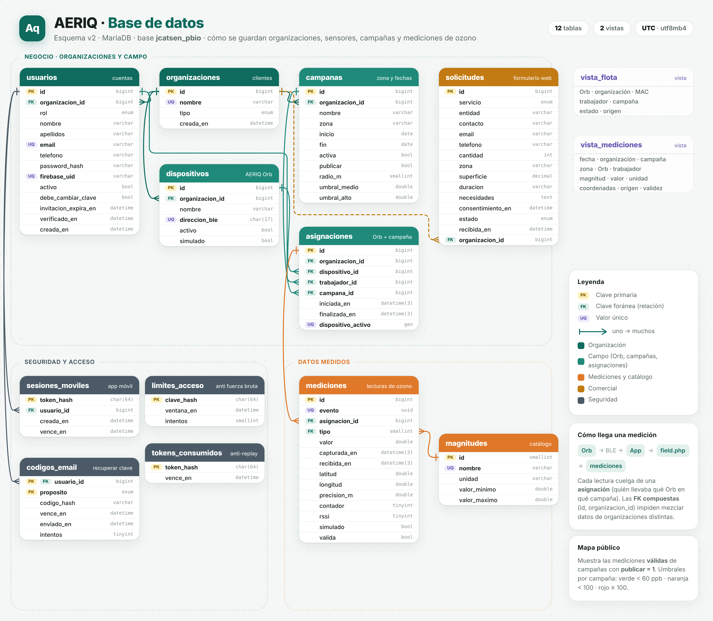

# Modelo de datos

El esquema de AERIQ usa once tablas y dos vistas en MariaDB. Las lecturas de ozono y temperatura comparten la tabla `mediciones`. La instalación limpia está en [Reinstalar AERIQ](../src/database/reinicio/LEEME.md).



El diagrama v2 representa bien las relaciones de medición. Dibuja además el tipo de organización, el vínculo entre solicitud y organización, la fecha de creación de sesión y la tabla `tokens_consumidos`. El código actual no usa esos elementos. El esquema mantiene las solicitudes separadas de las organizaciones, la sesión móvil con su fecha de caducidad y la identidad de Google mediante el UID único. También elimina `identificador_legacy` y `origen_importacion` de las tablas operativas. La importación histórica conserva los valores y los UUID de las lecturas.

## Once tablas

| Tabla | Qué guarda |
| --- | --- |
| `organizaciones` | Nombre de cada entidad y fecha de alta |
| `usuarios` | Identidad, organización, rol, hash de contraseña, UID de Google, activación e invitación |
| `campanas` | Zona, fechas, publicación, umbrales y radio de interpolación |
| `dispositivos` | Orb, organización, MAC BLE, alta y procedencia real/simulada |
| `asignaciones` | Historial Orb–trabajador–campaña (una sola abierta por Orb) |
| `magnitudes` | Catálogo fijo: 14 = ozono (ppb), 12 = temperatura (°C), igual que el tipo de trama BLE |
| `mediciones` | Evento único, asignación, magnitud, valor, fechas UTC, GPS opcional y validez |
| `solicitudes` | Peticiones comerciales de la web y su estado |
| `codigos_email` | Hash de códigos de recuperación de un solo uso |
| `sesiones_moviles` | Hash del token de la app y caducidad |
| `limites_acceso` | Contadores de intentos para frenar ataques de fuerza bruta |

`vista_flota` y `vista_mediciones` facilitan la lectura en phpMyAdmin. No son copias de datos ni endpoints públicos.

## Relaciones

```
organizaciones ─┬─< usuarios ──────┐
                ├─< dispositivos ──┼──< asignaciones >── campanas >─┘
                └─< campanas ──────┘         │   (1 vigente por Orb)
                                            └──< mediciones >── magnitudes
usuarios ─< sesiones_moviles · codigos_email
solicitudes · limites_acceso (tablas independientes)
```

- **Organización:** todo cuelga de ella. Las claves foráneas compuestas `(id, organizacion_id)` impiden asignar un Orb, trabajador o campaña de otra organización.
- **Asignación:** une trabajador, Orb y campaña con fecha de inicio. No se edita: al reasignar se cierra (`finalizada_en`) y se abre otra, así cada medición conserva su autoría.
- **Medición:** cuelga de su asignación. El UUID `evento` es único y hace idempotentes los reenvíos del móvil. `simulado` se copia del Orb al recibirla. El GPS se guarda completo o no se guarda.
- **Mapa público:** muestra el ozono válido con coordenadas de campañas con `publicar = 1`. Los informes de organización pueden consultar ozono y temperatura, también sin coordenadas.

## Acceso y privacidad

No hay registro público: el administrador de cada organización crea las cuentas. Una invitación deja la cuenta pendiente con contraseña temporal (24 h por defecto); cambiarla o entrar con Google la activa. `usuarios.firebase_uid` vincula la cuenta de Google en el primer acceso, que solo se permite si el correo ya existe.

Solo se guardan hashes de contraseñas, códigos y tokens. Los permisos se comprueban en el servidor antes de cada consulta.
